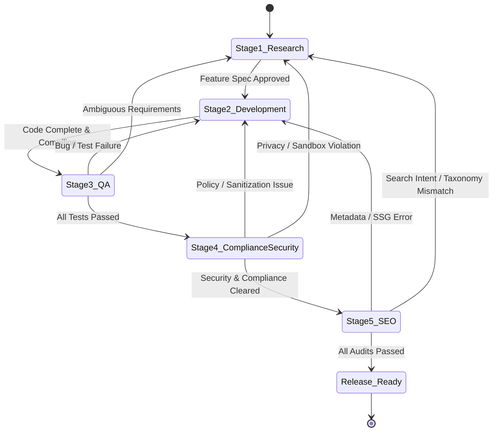

# Bidirectional Stage Feedback & Communication Protocol

This protocol defines how the 5 stages of the Product Change Lifecycle communicate back and forth when defects, ambiguities, security violations, or optimization gaps are detected.

---

## 1. Core Principles

1. **Non-Linear Execution**: A stage finding an issue never silently patches downstream assumptions; it immediately raises a structured **Feedback Packet** to the responsible upstream stage.
2. **Explicit Target Routing**: Every issue must have a single `targetStage` responsible for addressing the root cause.
3. **Traceability & Verification**: An issue ticket remains in `OPEN` or `RESOLVING` state until the originating stage explicitly verifies and marks it `CLOSED`.
4. **Circuit Breakers**: If a feedback loop bounces between two stages more than **3 iterations**, the workflow pauses and requests explicit user intervention to resolve the architectural conflict.

---

## 2. Stage Communication Matrix

| Originating Stage | Target Stage | Common Triggers | Action Required by Target Stage |
| :--- | :--- | :--- | :--- |
| **QA Testing** | **Development** | Unit test failure, runtime crash, uncaught exception on edge case, type error | Fix implementation in `engine.ts` or `ui.tsx`, re-run unit tests |
| **QA Testing** | **Research** | Contradictory formula specs, missing boundary definition, ambiguous UX requirement | Clarify specification, update RFC/formula citations |
| **Compliance & Security** | **Development** | Missing `reviewPolicy`, invalid review cadence, unvetted `dangerouslySetInnerHTML`, secret leaked into URL hash | Update metadata in `definition.ts`, add sanitization, disable URL state sync for secrets |
| **Compliance & Security** | **Research** | Requested feature requires external backend API or remote scraping (violating 100% in-browser privacy rule) | Redesign feature architecture for pure local/client-side execution |
| **SEO Analysis** | **Development** | Missing entry in `src/core/seo-data.ts`, title/description outside character limits, SSG build failure | Add/update SEO config, fix semantic headings or SSG prerender hooks |
| **SEO Analysis** | **Research** | Tool title or slug conflicts with high-intent search terminology, missing core user keywords | Re-align feature naming and category taxonomy |
| **Development** | **Research** | Technical infeasibility discovered during coding, missing parameter schemas | Provide alternate client-side algorithm or revise parameter bounds |

---

## 3. Standard Feedback Packet Format

All back-and-forth messages between stages must conform to the following schema:

```json
{
  "ticketId": "FBP-20261103-01",
  "fromStage": "qa",
  "toStage": "development",
  "severity": "BLOCKER",
  "component": "src/tools/tax-calculator/engine.ts",
  "summary": "Division by zero when total deductions equal gross income",
  "details": "When grossIncome is 50000 and deductions are 50000, effectiveRate calculation computes (0 / 0) resulting in NaN.",
  "reproduction": "npm test -- -t 'handles zero taxable income'",
  "requiredCorrection": "Add guard clause in calculateEffectiveTaxRate to return 0 when grossIncome is zero or equal to deductions.",
  "status": "OPEN",
  "iteration": 1
}
```

### Severity Tiers:
- **`BLOCKER`**: Prevents build, breaks tests, leaks private data, or violates the 100% in-browser sandbox. Halts progress.
- **`CRITICAL`**: Missing statutory review policy, broken core calculation, or failed SSG prerender.
- **`WARNING`**: Suboptimal SEO length, minor UX styling inconsistency, or missing optional formula citations.

---

## 4. State Machine & Resolution Flow



### Convergence Protocol:
1. When a target stage completes changes to resolve a ticket:
   - Target stage sends back the revised code/spec along with a `RESOLUTION_SUMMARY`.
   - The originating stage re-runs its audit.
   - If resolved: Ticket marked `VERIFIED & CLOSED`, workflow proceeds to next gate.
   - If unresolved: Ticket iteration counter increments (`iteration++`). If `iteration > 3`, escalate to the user with full context.
